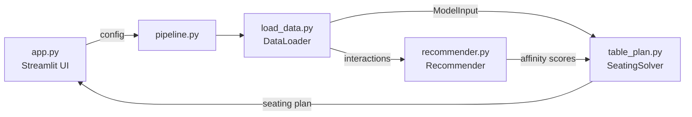

# Ménage à table

**Item-based collaborative filtering and constraint optimisation for conference dinner seating plans.**

Building a gala-dinner seating plan by hand is slow and fragile. Delegates want to sit with colleagues from their school, exhibitors want to sit with their target audience, some schools pay for whole tables, and the guest list changes on the day. One late change can mean rearranging half the room.

This project turns the seating plan into an optimisation problem:

1. A **recommender** (item-based collaborative filtering) learns how well each school and each exhibiting company go together, using QR badge-scan data from the daytime conference.
2. A **constraint solver** (Google OR-Tools CP-SAT) seats every guest under the table rules and seats schools with the companies they are most likely to want to meet.
3. A **Streamlit app** lets non-technical event staff change the settings, re-run the solver and download the plan without help from a data professional.

> The datasets in this repo are dummy data. An LLM generated the names of organisations and individuals, so any similarity to real people or organisations is coincidental.

---

## Contents

- [Quickstart](#quickstart)
- [Using the app](#using-the-app)
- [How it works](#how-it-works)
  - [Architecture](#architecture)
  - [Data loading](#data-loading)
  - [Recommender](#recommender)
  - [Seating optimiser](#seating-optimiser)
- [Datasets](#datasets)
- [Using your own data](#using-your-own-data)
- [Evaluating the recommender](#evaluating-the-recommender)
- [Project structure](#project-structure)
- [Known limitations](#known-limitations)
- [Roadmap](#roadmap)

---

## Quickstart

### Requirements

- Python **3.14+**
- [Poetry](https://python-poetry.org/) (recommended) or pip

### 1. Clone the repo

```bash
git clone https://github.com/Mike-Brennan-1/table_plan.git
cd table_plan
```

### 2. Install dependencies

**With Poetry** (this also creates a virtual environment):

```bash
poetry install
```

**With pip:**

```bash
pip install -r requirements.txt
```

### 3. Launch the app

Run this from the **repository root**, because the dataset paths in [`data_config.py`](src/table_plan/data_config.py) are relative to it:

```bash
# Poetry
poetry run streamlit run src/table_plan/app.py

# pip
streamlit run src/table_plan/app.py
```

Streamlit opens the app in your browser, usually at <http://localhost:8501>.

---

## Using the app

When the app opens, it loads the delegate and exhibitor datasets and shows:

- **Total guests**: delegates plus exhibitors.
- **Minimum required tables**: total guests divided by the maximum table size, rounded up.
- **Dataset preview**: the cleaned delegate and exhibitor tables.

Choose the settings in the sidebar, then click **Run Seating Optimisation**.

| Setting | Range (default) | Effect |
|---|---|---|
| Number of tables | 5–100 (40) | How many tables the solver can use. |
| Maximum people per table | 4–20 (10) | Hard upper limit on table size. |
| Minimum people per table | 0–max (75% of max) | Every table that is used must have at least this many people. Unused tables are allowed. |
| Exhibitors must sit together | on/off (on) | Seats all exhibitors from the same company at one table. |
| Maximum companies per table | 1–5 (2) | Limits how many exhibiting companies share one table. |
| Use QR scanning data to group by interactions | on/off (on) | Runs the recommender and maximises school–company affinity. When off, the solver only satisfies the constraints. |

The seating plan appears as a table listing each guest's table, type (delegate or exhibitor), name, organisation and job title. Use the download icon on the table to export it as a `.csv` file.

If the solver reports **"No feasible solution found"**, the settings contradict each other. For example, there may not be enough tables × maximum seats for all guests, or the minimum table size may be impossible to meet. Add tables, raise the maximum or lower the minimum, then run it again.

---

## How it works

### Architecture



`pipeline.run_pipeline(config)` coordinates the run:

1. `DataLoader` loads, renames and combines the delegate and exhibitor CSVs, then builds a `ModelInput`.
2. If affinity is enabled, it loads the interactions and passes them to `Recommender`, which returns a school × company affinity matrix.
3. `SeatingSolver` builds and solves the CP-SAT model and returns a `{table: {"delegates": [...], "exhibitors": [...]}}` dictionary.

### Data loading

[`load_data.py`](src/table_plan/load_data.py) is **driven by configuration**: file paths and column mappings live in [`data_config.py`](src/table_plan/data_config.py), not in the code. For each source, `DataLoader`:

- keeps only the columns listed in `col_map` and renames them to a common schema (`organisation`, `First name`, `Surname`, `Job Title`, `whole tables booked`);
- tags each row with a `type` (`delegate` or `exhibitor`);
- concatenates the sources and assigns every guest a `guest_id`;
- assigns a `group_id` to each unique `organisation` (school or company).

Interactions are then matched to these groups by school name and company name. Duplicate scans collapse to one row per school–company pair.

`prepare_model_inputs()` returns a `ModelInput` dataclass. This is the only interface between data loading and modelling:

```python
@dataclass
class ModelInput:
    delegates: list[int]                     # guest_ids
    exhibitors: list[int]                    # guest_ids
    delegate_school: dict[int, int]          # guest_id -> school group_id
    exhibitor_company: dict[int, int]        # guest_id -> company group_id
    schools: set[int]
    companies: set[int]
    interactions: Optional[dict[tuple[int, int], int]] = None   # (school, company) -> affinity
    exclusive_schools: Optional[dict[int, int]] = None          # school -> whole tables booked
```

Any new data source (for example the Dataverse API instead of CSV files) only has to produce a valid `ModelInput`. Nothing downstream has to change.

### Recommender

[`recommender.py`](src/table_plan/recommender.py) uses **item-based collaborative filtering**, with schools as users and exhibiting companies as items.

1. **Sparse interaction matrix.** School–company scans become a binary SciPy `csr_matrix` (`1` = at least one scan, `0` = none recorded).
2. **Item similarity.** Cosine similarity between company columns gives a company × company similarity matrix.
3. **Prediction.** Multiplying the interaction matrix by the similarity matrix gives a dense score for every school–company pair. A school can score highly for a company it never visited if it visited similar companies.
4. **Normalisation.** Each row is L1-normalised so that schools that visited many stands don't dominate.
5. **Integer scaling.** CP-SAT needs integer coefficients, so scores are multiplied by 10,000 and cast to `int`.

### Seating optimiser

[`table_plan.py`](src/table_plan/table_plan.py) builds the model with OR-Tools CP-SAT. Helper functions are in [`ortools_utils.py`](src/table_plan/ortools_utils.py).

**Decision variables** (all Boolean unless stated):

| Variable | Meaning |
|---|---|
| `x[d, t]` | Delegate `d` sits at table `t` |
| `y[e, t]` | Exhibitor `e` sits at table `t` |
| `z[s, t]` | School `s` is present at table `t` |
| `k[c, t]` | Company `c` is present at table `t` |
| `table_used[t]` | Table `t` is in use |
| `n[t]` (int) | Number of people at table `t` |
| `spread` (int) | Total number of school–table pairs, i.e. how spread out the schools are |
| `q_sc[s, c, t]` | School `s` and company `c` share table `t` (only created when affinity is on) |

**Constraints:**

- Every delegate and every exhibitor sits at exactly one table.
- `minimum × table_used[t] ≤ n[t] ≤ maximum × table_used[t]`.
- A delegate can only sit at a table where their school is marked present.
- At most `max_companies` companies per table.
- **Whole-table bookings:** a school that booked *N* whole tables appears at exactly *N* tables, and no other school sits at those tables.
- **Exhibitors sit together** (optional): every company appears at exactly one table, with all of its exhibitors.
- `q_sc[s, c, t]` can only be true when both `z[s, t]` and `k[c, t]` are true.

**Objective:**

- Affinity **off**: minimise `spread` so each school is split across as few tables as possible.
- Affinity **on**: maximise the sum of `affinity(s, c) × q_sc[s, c, t]`, i.e. the total affinity of school–company pairs that share a table. (See [Known limitations](#known-limitations) for how this interacts with `spread`.)

---

## Datasets

Three dummy CSV exports in the format of Dynamics 365 CRM tables are in [`src/table_plan/data/`](src/table_plan/data/):

| File | Rows | Contents | Columns used |
|---|---|---|---|
| `delegates.csv` | ~200 | Conference delegates (school leaders) | `School Account (Conference Register)`, `first_name`, `last_name`, `Job Title`, `whole tables booked` |
| `exhibitors.csv` | ~80 | Exhibitors (sponsoring companies) | `company`, `first_name`, `surname`, `Status Reason`, `whole tables booked` |
| `interactions.csv` | ~450 | QR badge scans made at exhibitor stands during the day | `Company`, `school name` |

Other columns (checksums, modified dates, region and so on) are ignored when the data is loaded.

---

## Using your own data

1. Put your CSVs in `src/table_plan/data/` (or anywhere else, and update the paths).
2. Edit [`data_config.py`](src/table_plan/data_config.py). In each `col_map`, the keys are **your** column names and the values are the internal names the model expects:

```python
DELEGATE_CONFIG = {
    "path": "src/table_plan/data/delegates.csv",
    "col_map": {
        "<your school column>":        "organisation",
        "<your first-name column>":    "First name",
        "<your surname column>":       "Surname",
        "<your job-title column>":     "Job Title",
        "<your whole-tables column>":  "whole tables booked",
    },
    "type": "delegate",
}
```

The interactions config must map to `Company` and `School`. These values must **exactly match** the `organisation` values in the exhibitor and delegate files, because they are joined by name.

> Each `col_map` key must be unique. Python dictionaries silently drop duplicate keys, which then causes a Polars schema-length error when the sources are concatenated.

---

## Evaluating the recommender

Missing interactions aren't true negatives (a school may simply not have visited a stand yet), so a standard train/test split doesn't work. `RecommenderEvaluator` uses Monte Carlo masking instead:

1. Randomly hide 10% of the known interactions (`random_mask`).
2. Retrain the similarity matrix on what remains and predict the hidden pairs.
3. Score the predictions with **binary cross-entropy** (log loss), averaged over `n_runs` random masks (`evaluate_multiple`).

On the project data, the mean BCE over 20 runs was **0.48**.

`evaluate_solution()` gives a measure that non-technical users can follow: the total affinity at each table of the final plan, which lets you compare runs with and without QR data.

Example, run from the repository root:

```python
import sys; sys.path.insert(0, "src/table_plan")

from load_data import DataLoader
from recommender import Recommender, RecommenderEvaluator

loader = DataLoader(loading_interactions=True)
combined = loader.join_datasets()
interactions = loader.load_interactions(combined)

evaluator = RecommenderEvaluator(Recommender())
print(evaluator.evaluate_multiple(interactions, n_runs=20))
```

---

## Project structure

```
table_plan/
├── pyproject.toml          # Poetry project config
├── poetry.lock             # Locked dependency versions
├── requirements.txt        # pip alternative to Poetry
├── src/table_plan/
│   ├── app.py              # Streamlit frontend
│   ├── pipeline.py         # Coordinates loading -> recommender -> solver
│   ├── data_config.py      # Source schemas, column maps, ModelInput dataclass
│   ├── load_data.py        # DataLoader: load, rename, combine, build ModelInput
│   ├── recommender.py      # Recommender (item-based CF) and RecommenderEvaluator
│   ├── table_plan.py       # SeatingSolver: CP-SAT model
│   ├── ortools_utils.py    # Helpers for building OR-Tools variables
│   └── data/               # Dummy delegates, exhibitors and interactions CSVs
└── tests/
```

### Tech stack

| Purpose | Library |
|---|---|
| DataFrames | [Polars](https://pola.rs/) |
| Sparse matrices | [SciPy](https://docs.scipy.org/doc/scipy/reference/sparse.html) |
| Similarity and normalisation | [scikit-learn](https://scikit-learn.org/) |
| Optimisation | [Google OR-Tools CP-SAT](https://developers.google.com/optimization/cp/cp_solver) |
| Frontend | [Streamlit](https://streamlit.io/) |
| Dependency management | [Poetry](https://python-poetry.org/) |

---

## Known limitations - to fix

- **Single objective.** CP-SAT keeps only the most recently set objective. When affinity is enabled, `maximise_objective()` replaces `minimise_spread()`, so schools are kept together only by the hard constraints, not by a spread penalty. Combining the two into one weighted objective (for example `affinity − spread × weight`) would restore the intended trade-off.
- **Minimal cleaning.** The loader selects and renames columns but does not yet remove duplicate bookings, drop no-shows (`No Show` / `Status Reason`) or reject null organisations. Clean the source files before loading them.
- **Name-based joins.** Interactions are matched to schools and companies by exact name, so spelling differences between CRM tables silently drop scans.
- **No time limit.** The solver runs until it finds an optimal solution. Very large events may need `solver.parameters.max_time_in_seconds` set.
- **Imports depend on the working directory.** Modules import each other by bare name (`from load_data import ...`) and the data paths are relative to the repository root. Run from the root as shown above.
